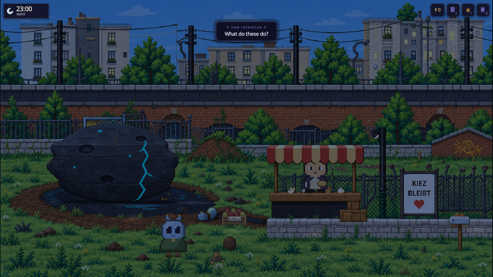
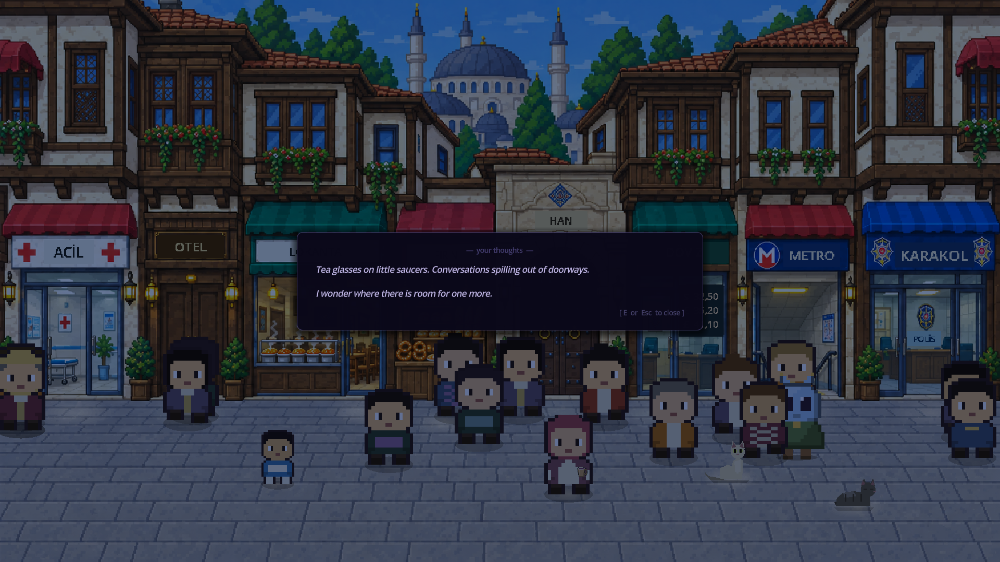

# Foreign to All

**A game about arriving somewhere you cannot read — and finding people who make room for you.**

Created by **Arda Aslan** · Narrative exploration · Godot / GDScript · Desktop beta

You arrive on Earth without a shared language. A gesture, an offered object, or an invitation becomes your first clue. Across eight cities, you learn to interpret both words and the situations around them. The central idea is simple: **communication is cultural; knowing the words is not enough.**

## Start here

This repository brings together the game, its source code, and supporting design work.

| Explore | Where to go |
| --- | --- |
| Watch the game in under three minutes | [Captioned gameplay overview (MP4)](https://github.com/aardaslann/foreign-to-all/releases/download/v0.2.1-beta.1/foreign-to-all-gameplay-research.mp4) |
| Play without installing Godot | [Download the Windows or Linux beta](https://github.com/aardaslann/foreign-to-all/releases/tag/v0.2.1-beta.1) |
| Understand the idea and design choices | [Project overview](docs/PROJECT.md) |
| Review the implementation | [Guided code tour](docs/CODE_TOUR.md) |
| See the player's journey | [Three-page design diagram (PDF)](docs/design/foreign-to-all-player-journey.pdf) · [Editable diagram](docs/design/foreign-to-all-player-journey.drawio) |
| Run or build the source | [Setup and verification](docs/BUILD_AND_TEST.md) |

The gameplay overview uses actual game footage recorded through the game's input paths. Its segments begin from prepared points in the journey; it is an edited demonstration, not one uninterrupted playthrough. [Recording method and editing source](trailer/src/research/README.md).

## The game

- **Eight city chapters:** Berlin, Istanbul, London, Paris, Moscow, Mumbai, Tokyo, and Mexico City. Berlin begins the journey; the other seven can be explored in any order.
- **Meaning discovered in context:** unfamiliar speech starts as glyphs. Notice the situation, try a response, and discover a meaning. A persistent word panel lets you write a guess or reveal the meaning.
- **More than vocabulary:** tone, formality, gesture, and implication matter. English is readable from the start, so London's challenge is understanding what people mean.
- **A notebook with evidence:** keep words, phrases, personal guesses, memories, and pronunciation playback together.
- **A journey toward belonging:** build relationships, return for each city's celebration, then return to Berlin for the naming ending.
- **Room to take your time:** reading pauses the clock; opportunities do not expire. Keyboard/controller support, text-size settings, and reduced motion support different ways of playing.

## Try the opening

Extract the complete Windows ZIP and open `ForeignToAll.exe`, or follow the Linux archive's start guide. No account, network connection, or engine installation is needed to play.

Choose **New Journey**, customize your alien, and explore the Berlin opening. Walk with **WASD / arrow keys**, interact with **E / Space**, open **Field Notes with J**, and pause with **Escape**. The [player guide](docs/beta-player-guide.md) covers controls, saves, travel, and accessibility settings.

## Source and supporting materials

| Folder | Contents |
| --- | --- |
| [`autoload/`](autoload/) | Persistent game state, story progression, travel, saves, audio, controls, and localization |
| [`scenes/`](scenes/) | Playable scenes, characters, conversations, word discovery, notebook, and menus |
| [`art/`](art/) and [`audio/`](audio/) | Bundled game assets, environment data, fonts, music, and speech |
| [`tools/`](tools/) | Regression checks, packaging tools, asset-production utilities, and capture scripts |
| [`trailer/`](trailer/) | Remotion / React / TypeScript source for promotional films and gameplay edits |
| [`docs/`](docs/) | Project explanation, code tour, design diagrams, setup, and verification evidence |

This is a curated source snapshot prepared on **30 October 2026**, not a recreation of the project's development history. Runtime source and bundled assets are preserved from the working project. The snapshot omits editor caches, private research/account notes, redundant review captures, and generated build outputs; playable packages and finished videos are release attachments. Older design documents are retained as process material and are identified in the [design index](docs/design/README.md).

## Development and current status

Arda Aslan leads the concept, creative and design direction, production, and iteration. Character voices were produced with ElevenLabs, and the city music with Suno. See [development and materials](docs/DEVELOPMENT.md) for the scope of the included work and third-party notices.

**Version:** `0.2.1-beta.1`. The eight-city core journey is implemented. English is the complete interface; other interface languages are previews. Native-language review and wider human playtesting remain in progress. This repository does not claim measured language-learning outcomes. [Verification and limitations](docs/VERIFICATION.md).

The source is available for review; no general open-source license is granted. Third-party components retain their own terms. See [rights and credits](RIGHTS.md) and [third-party notices](THIRD-PARTY-NOTICES.txt).
